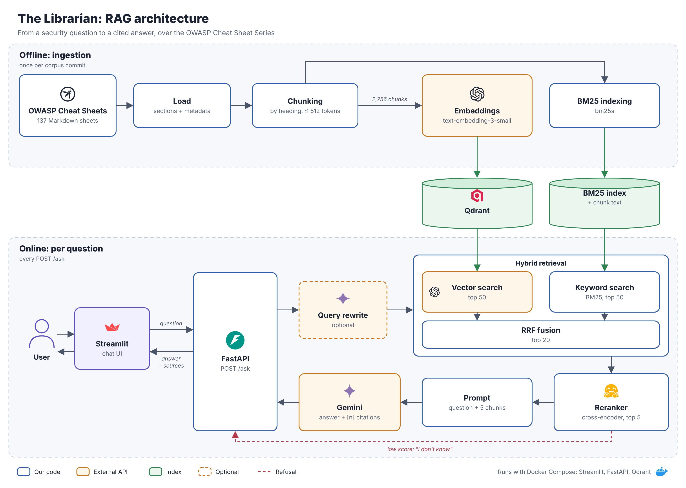

# The Librarian — RAG over the OWASP Cheat Sheet Series

CS496 AI Engineering, Project 2. A retrieval-augmented service that answers
application-security questions from the OWASP Cheat Sheet Series, with
citations, and says "I don't know" when the corpus doesn't cover something.

## Architecture



Offline (once per corpus commit): load → chunk → embed + BM25-index into
Qdrant. Online (every question): hybrid retrieval (vector + BM25, RRF
fusion) → cross-encoder rerank → generation, with a low-score refusal path.
Runs via Docker Compose (Streamlit, FastAPI, Qdrant) — no Kubernetes. See
`docs/design.md` for the reasoning behind each piece; an editable source is
at `docs/architecture.svg`.

## Corpus

[OWASP Cheat Sheet Series](https://github.com/OWASP/CheatSheetSeries),
licensed [CC BY-SA 4.0](https://github.com/OWASP/CheatSheetSeries/blob/master/LICENSE.md).
Pinned at commit `a5fbb7f886c02e3418e17f5525874a868cca49e4`. The corpus for
this project is only the files under `cheatsheets/*.md` (137 files) —
`cheatsheets_draft/`, the `Index*.md` files, and repo tooling files are
excluded.

### Fetching the corpus

```bash
scripts/fetch_corpus.sh
```

Clones (or reuses) `corpus/CheatSheetSeries` and checks out the pinned
commit above, so the eval dataset's recorded source files/passages stay
valid. `corpus/` is gitignored — it is not committed to this repo.

## Offline indexing

Embeddings come from a hosted API (not a local model); the vector index is
[Qdrant](https://qdrant.tech), running locally via Docker Compose. BM25
stays local, in Python. See `docs/design.md` ("Index choice") for why.

```bash
docker compose up -d              # starts Qdrant on localhost:6333
cp .env.example .env              # then fill in EMBEDDING_API_KEY and EMBEDDING_MODEL
python3 -m venv .venv && source .venv/bin/activate
pip install -r requirements.txt
scripts/fetch_corpus.sh
scripts/build_index.sh            # builds the chosen chunking config into data/index/
```

`scripts/build_index.sh` doesn't start Qdrant itself — it checks it's
reachable and that `.env` has the required variables, then builds. Override
the chunking config with env vars, e.g. `STRATEGY=fixed MAX_TOKENS=256
scripts/build_index.sh`. `.env` is gitignored and never read or printed by
any script beyond pulling the variable values it needs — see `.env.example`
for the full list of variables.

`data/index/` (chunk text/metadata + BM25 index per config) and
`data/cache/embeddings/` (the embedding cache) are both gitignored and
regenerated by the build, not committed.

## Data

- **`data/eval.json`** — the final, human-reviewed eval set: 119 questions,
  every row `verified: true`.
- **`data/dev.jsonl`** / **`data/test.jsonl`** — `eval.json` split ~25/75,
  sheet-disjoint (no OWASP cheat sheet appears in both), seeded and
  reproducible via `scripts/split_eval.py`. See `data/SPLIT.md` for exact
  counts and the regenerate command. **dev is for tuning; test is only for
  final and Week 8 before/after numbers.**
- `data/eval_draft.json` — the original 120 LLM-drafted questions,
  pre-review. Kept for audit only; nothing downstream reads it.
- `data/REVIEW_STATS.md` — the draft-vs-final diff (kept/edited/deleted,
  and why).
- `data/SCHEMA.md` — the field format shared by all of the above.

Quality-check freezing has not happened separately from human review — see
`data/REVIEW_GUIDE.md` and `data/REVIEW_STATS.md` for how `eval.json` was
produced.

## Online retrieval

`src/retrieval/retriever.py` answers a question from the **already-built** indexes (it never rebuilds or re-embeds anything). It needs Qdrant running, `.env` filled in (same `EMBEDDING_MODEL` the index was built with — checked against `manifest.json`), and `data/index/heading_mt512_min20/` present.

```python
from src.retrieval import Retriever, format_context

retriever = Retriever.from_config()          # load once
result = retriever.retrieve("how should I store passwords?", top_k=5)   # mode="hybrid" | "vector" | "bm25" | "hybrid+rerank"
context = format_context(result.chunks)      # numbered [1], [2]... block for the generation prompt
```

Each `RetrievedChunk` carries `chunk_id`, `source_file`, `title`, `section_path`, `text`, `score`, `rank`, `source_url`, `rerank_score` (set only when a reranker is attached) plus per-retriever `vector_score`/`vector_rank`/`bm25_score`/`bm25_rank`. Hybrid fuses the two rankings with Reciprocal Rank Fusion; `hybrid+rerank` additionally reranks hybrid's top 20 with a cross-encoder (see `docs/design.md`'s "Retrieval" section). Optional `filters={"source_file": ..., "has_code": True}` and `min_vector_score` ("I don't know" gate, calibrate it first).

```bash
python -m src.retrieval "how should I store passwords?" --context
python eval/retrieval_eval.py            # dev-set ablation: bm25 / vector / hybrid / hybrid+rerank + score calibration
python -m unittest tests.test_retriever  # offline unit tests (no Qdrant / API key)
```

## Answer generation

`src/generation/` turns retrieved chunks into a cited answer with Google Gemini (embeddings stay on OpenAI). It reuses the `Retriever` above unchanged: hybrid retrieval, cross-encoder rerank of the top 20, top 5 chunks numbered `[1]`…`[5]` by `format_context`, then one Gemini call that must answer only from those sources and return JSON `{"answerable": bool, "answer": str}`.

```python
from src.generation import ask

result = ask("how should I store passwords?")
print(result.format())        # answer with [n] citations + the cited OWASP URLs
result.answerable             # False -> result.answer is the fixed "I don't know" text
result.refusal_reason         # why: no_results / model_declined / no_valid_citations / invalid_model_output ...
result.citations              # Source(number, title, section_path, source_file, source_url, chunk_id) per cited [n]
```

"I don't know" happens at four points, each recorded in `result.refusal_reason`:

| reason | when | Gemini called? |
|---|---|---|
| `empty_query` / `no_results` / `below_vector_score_threshold` | retrieval returned nothing | no (free) |
| `model_declined` | Gemini says the sources don't answer the question (the primary mechanism, per `docs/design.md`'s "I don't know" threshold section) | yes |
| `no_valid_citations` | Gemini answered but cited no real source (citations to numbers it wasn't given are stripped; an answer left with none can't be checked, so it is refused) | yes |
| `invalid_model_output` | output blocked, empty, or not the requested JSON | yes |

Files: `src/generation/prompt.py` (system prompt + JSON schema), `gemini.py` (client, retries on 429/5xx), `answer.py` (citation check, refusal rules, `answer_question()`, `Librarian`, `ask()`, CLI), `tests/test_generation.py`.

### Running it (teammates: start here)

Prerequisites: the offline index already built on your machine (`data/index/heading_mt512_min20/` with `chunks.jsonl`, `bm25/`, `manifest.json`) and its Qdrant volume. **Nothing below rebuilds the index or re-embeds the corpus.**

1. Pull and install the one new dependency (`google-genai`, now in `requirements.txt`):

   ```bash
   git pull
   source .venv/bin/activate            # Windows PowerShell: .\.venv\Scripts\Activate.ps1
   pip install -r requirements.txt
   ```

2. Add the Gemini key to your existing `.env` (copy the new lines from `.env.example`). Get a key at <https://aistudio.google.com/apikey>. Keep the existing OpenAI `EMBEDDING_API_KEY` / `EMBEDDING_MODEL=text-embedding-3-small` unchanged: questions are still embedded with OpenAI; Gemini only writes the answer.

   ```bash
   GEMINI_API_KEY=your-key-here
   # GEMINI_MODEL=   optional, default gemini-flash-latest; pin an exact id for reproducible eval runs
   ```

3. Offline tests (no keys, no Qdrant, no credits; Gemini/OpenAI/Qdrant are mocked). Expect `Ran 34 tests ... OK` (58 with `tests.test_api tests.test_ui` added, which need `requirements-ui.txt` too):

   ```bash
   python -m unittest tests.test_generation tests.test_retriever -v
   ```

4. Gemini alone: 2 real Gemini calls on two built-in Password Storage excerpts, no Qdrant/OpenAI needed. Expect the Argon2id question answered with `[1]` + an OWASP link, and the Android TLS question answered "I don't know" with `refusal_reason: model_declined`:

   ```bash
   python -m src.generation --smoke
   ```

5. Full pipeline (Qdrant up via `docker compose up -d`; one OpenAI embedding call + one Gemini call per question):

   ```bash
   python -m src.generation "how should I store passwords?"            # hybrid + rerank (default)
   python -m src.generation "how should I store passwords?" --no-rerank  # skip the cross-encoder
   python -m src.generation "how do I bake sourdough bread?"           # should say "I don't know"
   python -m src.generation "how should I store passwords?" --json     # every field, incl. timings
   ```

Troubleshooting: `GEMINI_API_KEY is not set` -> step 2. Gemini `404` -> `GEMINI_MODEL` names a model your key can't use; unset it. `429` -> free-tier rate limit, wait and retry. `has no chunks.jsonl` / `Qdrant collection ... is not available` -> the existing index or Qdrant isn't there (same errors as `python -m src.retrieval`).

## HTTP API

`src/api/` serves the `Librarian` above over HTTP with FastAPI. It loads the index, reranker and Gemini client once at startup and reuses them for every request; it never rebuilds the index. Same prerequisites as the full pipeline: the built index, Qdrant up, and `.env` filled in.

```bash
pip install -r requirements.txt          # adds fastapi, uvicorn, httpx
python -m src.api                        # http://127.0.0.1:8000, interactive docs at /docs
# or: uvicorn src.api.app:app --host 0.0.0.0 --port 8000
```

| endpoint | does |
|---|---|
| `POST /ask` | body `{"question": str, "top_k": int = 5}` (question 1-1000 chars, top_k 1-10). Returns the `Answer` fields: `answer`, `answerable`, `refusal_reason`, `citations`, `sources`, `invalid_citations`, `model`, `timings_ms`. An "I don't know" is a normal `200` with `answerable: false`. |
| `POST /feedback` | body `{question, answer, answerable, refusal_reason, cited_chunk_ids, model, rating: "up"\|"down", comment}`, appended as one line to `data/feedback/feedback.jsonl` (gitignored). Returns `204`. Stores what was asked and answered, never who asked (no IP, no user id). Works even if the index failed to load. |
| `GET /health` | `200` when the index is loaded and Qdrant still holds one point per chunk; `503` otherwise, with the reason in `error` or `qdrant`. |

```bash
curl -s localhost:8000/health
curl -s -X POST localhost:8000/ask -H 'content-type: application/json' \
  -d '{"question": "how should I store passwords?"}'
```

Status codes: `422` bad input (checked before any retrieval or API call), `502` an upstream call failed (OpenAI, Qdrant or Gemini; logged server-side, not echoed to the client), `503` the Librarian failed to load at startup (the app still starts so `/health` can say why).

Options in `.env`: `LIBRARIAN_RERANK=false` skips the cross-encoder (no torch needed, faster, lower recall@5), `LIBRARIAN_INDEX_DIR` points at a different built index.

```bash
python -m unittest tests.test_api -v     # offline: fake retriever + fake Gemini, no keys or Qdrant
```

## UI

`src/ui/app.py` is a Streamlit page that talks to the API over HTTP only (`API_URL`), so it needs no index, no torch and no keys.

```bash
pip install -r requirements-ui.txt                          # streamlit, httpx
python -m src.api                                           # terminal 1: the API
API_URL=http://127.0.0.1:8000 streamlit run src/ui/app.py   # terminal 2: http://localhost:8501
```

A three-pane console:

- **Left:** this session's questions (unanswered ones in amber), index status, and how many passages are sent to the model.
- **Middle:** the question, the answer with numbered `[n]` citations, per-stage timings (vector, bm25, rerank, generation, total) and how many of the passages given were cited, then Helpful / Not helpful (with an optional comment) sent to `POST /feedback`.
- **Right:** one tab per cited source showing the passage exactly as the model received it, with line numbers. Lines that share specific terms or values with the sentences citing that source are highlighted, as a reading aid. For "I don't know" answers it shows the passages that were searched instead.

Model output and passage text are HTML-escaped before rendering (the corpus is full of example attack payloads). The API returns each source's passage `text` for this pane. Theme in `.streamlit/config.toml` (read when Streamlit runs from the repo root).

```bash
python -m unittest tests.test_ui -v     # offline: API calls mocked
```

Not done yet: answer-quality evaluation on `data/dev.jsonl` (refusal on the unanswerable questions, citation correctness), and API/UI services in `docker-compose.yml`.